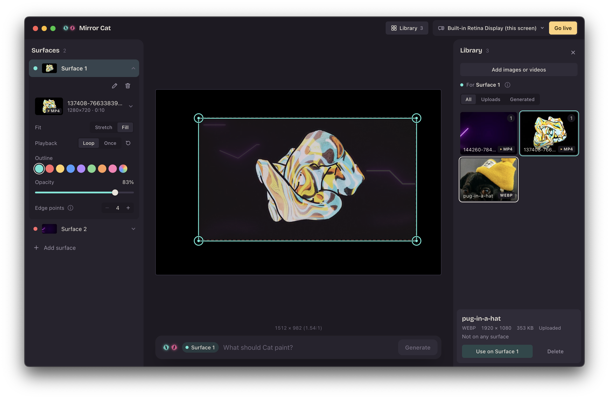

# MirrorCat

Projection mapping for home use. Draw shapes that match the real objects
in your room (a wall, a cabinet door, a box), put an image or video on
each one, bend it to fit, and send the result fullscreen to your
projector. Cat, the built-in assistant, generates content from a prompt.



## Quick start

```bash
npm install
npm run dev
```

1. Pick your projector from the display menu in the top bar and click
   **Go live**. A borderless, fullscreen output window opens on that
   display.
2. Select a surface (or **Add surface**) and give it content: drop an
   image or video onto the library, or describe one to Cat and hit
   **Generate**.
3. Drag the corner targets on the stage until the shape lines up with the
   real object on the wall. Add edge points for anything that isn't a
   rectangle.

Everything autosaves; close the app and it comes back as you left it.

## Features

**Surfaces**
- Any number of surfaces, each with its own media, outline color,
  opacity and visibility toggle
- Four draggable corner pins with large, easy-to-grab targets
- Edge points for non-rectangular shapes: double-click an edge to add
  one, select it and press Delete to remove; content bends to follow the
  shape (Coons-patch warp)
- Shift-drag a corner to resize in the media's proportions
- Undo / redo for shape edits (⌘Z / ⇧⌘Z, or Edit ▸ Undo / Redo); a whole
  drag is one step
- Layer ordering by drag in the Surfaces panel
- Rename and delete from each surface's settings drawer
- Automatic outline colors from a curated palette

**Media**
- Shared library of images and videos (PNG, JPG, WEBP, GIF, MP4, MOV,
  WebM), with All / Uploads / Generated filters
- Drag-and-drop import onto the library or the stage
- Stretch or Fill fit per surface; Loop or Once playback for video, with
  replay
- Placeholder AI generation through a pluggable provider interface

**Projection**
- Separate control and output windows: edit on the laptop, watch the wall
- Editor stage locked to the projector's aspect ratio, so shapes match
  what's projected
- Live sync to the projector as you edit
- Autosave of surfaces and calibration; media stored in the app's data
  folder

## TODO

**Next up**
- [ ] Preview mode: open the output as a normal window when the chosen
      display is the laptop screen
- [ ] Pick a real AI provider (still images vs. video is the open question)
- [ ] Guard against edge points folding the warp

**Editing**
- [ ] Undo for settings, media, reorder and surface deletion (shape edits
      only today)
- [ ] Arrow-key nudge for corners and edge points
- [ ] Smooth (curved) edges between edge points
- [ ] Optional outline on the projector for on-wall calibration
- [ ] Select a surface by clicking it on the stage

**Media & projects**
- [ ] Sound for video surfaces
- [ ] Named save / open and export of a scene with its media
- [ ] Show library disk usage

**Performance & hardware**
- [ ] One shared WebGL renderer per window (one context per surface today)
- [ ] Multiple projectors (one output window per display)
- [ ] Projector color / gamma calibration

**Before shipping**
- [ ] Upgrade Electron to 45+ (moderate WebHID/WebUSB advisory; the app
      doesn't use either)
- [ ] Code signing + notarization, and a real app icon
- [ ] Smoke-test a packaged build (`npm run build:mac`) on a clean machine

Details and reasoning for each item are in
[`docs/roadmap-and-risks.md`](docs/roadmap-and-risks.md).

## Checks and tests

- `npm run check` -- typecheck, lint (warnings fail) and unit tests.
- `npm run test:coverage` -- unit tests with a coverage report in
  `coverage/index.html`.
- `npm run test:e2e` -- builds, then launches the app with Playwright
  against a throwaway data folder (a MirrorCat window opens for a few
  seconds).

CI runs typecheck, lint, coverage and build on every push
(`.github/workflows/ci.yml`).

## Documentation

Full docs live in [`docs/`](docs/README.md):

- [Architecture](docs/architecture.md): processes, windows, data flow, IPC
- [Components](docs/components.md): what each file does
- [Surfaces & warping](docs/surfaces-and-warping.md): the surface model,
  edge points, the warp math, undo
- [Media library & autosave](docs/media-library.md)
- [Decisions](docs/decisions.md): why things are the way they are

## Wiring a real AI provider

`src/renderer/src/ai/contentService.ts` currently ships a
`MockPatternProvider` that turns a prompt into a deterministic gradient
+ ring pattern locally, with no network call -- it exists so the
generate -> texture -> warp pipeline is testable without an API key.

No real generation backend has been picked yet. That's a real product
decision, not just an implementation detail:

- **Still image vs. video/animation.** A static image on a wall reads as
  a poster; most home projection-mapping content people actually want
  (ambient motion, looping animation) needs a video or shader-loop
  output, which is a very different pipeline (and cost/latency profile)
  than an image model.
- **Provider + cost model.** Image models (e.g. an OpenAI/Stability/
  Replicate-style API) are cheap and fast per generation; video models
  are slower and meaningfully more expensive per generation -- matters
  for a "regenerate until it looks right" UX.
- **API key storage.** Whatever you pick, do not store the key in
  localStorage or commit it. Use Electron's `safeStorage` (OS keychain)
  from the main process and pass a handle/token to the renderer, not the
  raw key.

Once you've decided, implement `ContentProvider` (`generate(request)` ->
`GeneratedImage` bytes) and call `setContentProvider(new YourProvider())`.
The prompt panel saves the result into the media library.
