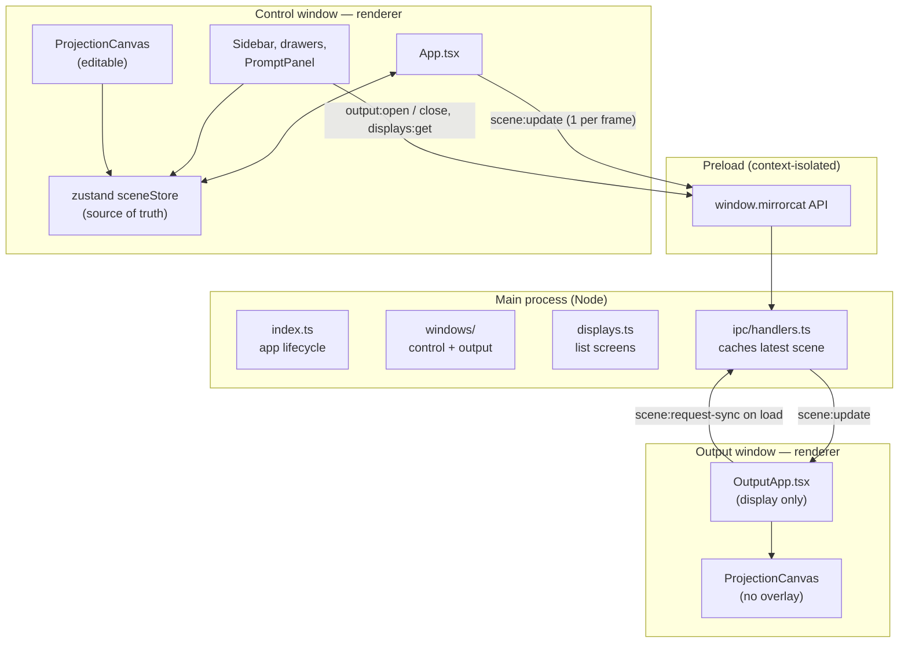

# Architecture

## The one-sentence version

One Electron app, two windows: a **control window** on your laptop where
you edit, and a borderless **output window** on the projector's display
that only renders. The control window owns all state; the output window is
a mirror kept in sync over IPC.

## Why two windows

Projection mapping is calibrated by looking at the wall, not the laptop.
You stand across the room, nudge a corner on the laptop, and watch the
projected image move. That only works if the editing UI and the projected
image are on different screens, so the split between "where you edit" and
"what the projector shows" is the product's central interaction, not
scaffolding. See [decision 003](decisions.md#003-two-windows-control-and-output).

## Stack

| Layer | Choice | Version (Oct 2026) |
| --- | --- | --- |
| Desktop shell | Electron | 41 |
| Build / dev server | electron-vite (Vite under the hood) | electron-vite 5, Vite 7 |
| Language | TypeScript, strict mode | 6 |
| UI | React | 19.2 |
| App state | zustand | — |
| Rendering | Three.js (WebGL) | 0.185 |
| Packaging | electron-builder | 26 |

`electron-vite@5` doesn't support Vite 8 yet, so Vite is pinned to `^7`.

## Process model

Both windows load the **same renderer bundle**. `src/renderer/src/main.tsx`
checks the URL hash: `#/output` renders `OutputApp`, anything else renders
the editor `App`. One build, two roles.

## Data flow

1. **You edit.** Dragging a corner, adding an edge node, changing opacity
   and so on calls an action on the zustand store
   (`src/renderer/src/state/sceneStore.ts`).
2. **The editor re-renders.** React components subscribed to the store
   update; each `ProjectionCanvas` pushes the new shape into its
   `ProjectionEngine`, which rewrites the mesh vertices in place.
3. **The scene is mirrored.** `App.tsx` subscribes to the store and sends
   the full `SceneState` to the main process, batched to at most **one
   send per animation frame** so a fast drag doesn't serialize every
   surface's image on every mouse move.
4. **Main caches and forwards.** `ipc/handlers.ts` keeps the latest scene
   and forwards it to the output window if one is open.
5. **The projector updates.** `OutputApp` replaces its scene and renders
   every *visible* surface with the same `ProjectionCanvas`, minus all
   editing chrome.

When the output window opens (or reopens), it asks main for the cached
scene so it never starts blank. A live update that arrives before that
reply wins over it, since Electron doesn't guarantee their order.

### What is and isn't synced

`SceneState` (`src/shared/types.ts`) is the synced contract:

- `surfaces`: geometry, edge nodes, color, opacity, visibility, fit, and
  `assetId` (a media library id)
- `outputDisplayId`: which display is live, or `null`

Images are **not** in the scene. Both windows load them from the
`mirrorcat-media://` protocol by id, so the per-frame sync stays small.
Main also autosaves each scene update (debounced) to `scene.json`. See
[media-library.md](media-library.md).

Pure editor UI state is **not** synced and lives in React component state:
which surface is selected, which drawers are open, the display list, which
display is picked in the dropdown. Keep it that way. The projector should
never re-render because a drawer opened.

## IPC contract

All channel names live in `src/shared/ipcChannels.ts`. Renderers never
touch `ipcRenderer` directly; they go through the typed
`window.mirrorcat` API exposed by the preload (`src/preload/index.ts`,
types in `src/preload/index.d.ts`).

| Channel | Direction | Kind | Purpose |
| --- | --- | --- | --- |
| `displays:get` | renderer → main | invoke | List connected displays (`DisplayInfo[]`). |
| `output:open` | renderer → main | invoke | Open the fullscreen output window on a display id. |
| `output:close` | renderer → main | invoke | Close it and clear the cached scene. |
| `scene:update` | control → main → output | send | Push the full scene; main caches and forwards. |
| `scene:request-sync` | output → main | invoke | Get the cached scene when the output window loads. |

## Coordinate system

Every surface point (corners and edge nodes) is stored **normalized, 0–1,
relative to the projector frame**: `(0, 0)` is the top-left of the
projected image and `(1, 1)` the bottom-right. Nothing stores pixels.

That's what lets the same scene drive a small editor preview and a
1920×1080 projector without conversion. Each `ProjectionEngine` multiplies
by its own container size when it builds the mesh. It also means the
editor stage must have the **same aspect ratio** as the projector for
shapes to look the same in both. The stage locks to the chosen display's
shape for exactly this reason
([decision 008](decisions.md#008-editor-stage-locked-to-the-projectors-aspect-ratio)).

## Security posture (current)

- `contextIsolation: true`, `nodeIntegration: false` on both windows. The
  renderer only sees the narrow `window.mirrorcat` API.
- `sandbox: false` on both windows, and **no Content-Security-Policy** in
  `src/renderer/index.html`. Both are deliberate MVP shortcuts and must be
  fixed before shipping. See [roadmap](roadmap-and-risks.md).
- External links open in the OS browser; the app window never navigates
  away (`setWindowOpenHandler` in `controlWindow.ts`).
